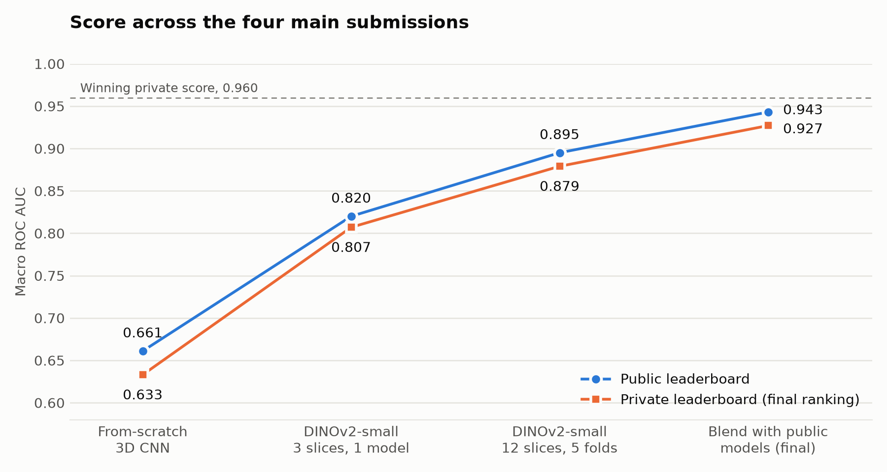
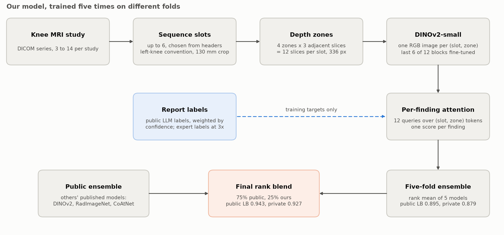

# Knee MRI Abnormality Detection

Multi-label detection of 12 knee abnormalities from MRI, built for the
[RSNA Knee Abnormality Detection](https://www.kaggle.com/competitions/rsna-knee-abnormality-detection)
challenge on Kaggle (2026). The task was to score each study for 12 findings, using images only,
when almost none of the training data had labels.

## Final result

| Measure | Result |
|---|---|
| **Final score (private leaderboard, macro ROC AUC)** | **0.927** |
| **Final rank** | **3,016 of 6,299 teams** |
| Public leaderboard score | 0.943 |
| Winning private score | 0.960 |
| Median private score | 0.925 |
| Best score from only the models trained here | 0.879 private, 0.895 public |

The final submission blends the five models trained here with a large public ensemble that other
participants published, which the challenge rules allowed. Most of the jump from 0.879 to 0.927
comes from those public models, so **0.879 is the fair measure of the original work** and 0.927 is
the score of the blend.



## The problem

- **The task:** 12 scores per study: ACL, MCL, medial and lateral meniscus, medial, lateral and
  patellofemoral osteoarthritis (OA), effusion, synovitis, Baker's cyst, contusion and fracture.
- **The metric:** the plain average of per-finding ROC AUC. It only reads rank order, so calibration
  doesn't matter.
- **Very few labels:** only 58 of the 4,407 training studies have expert labels. The other 4,349 have
  only a free-text radiology report, written in about nine languages.
- **No reports at test time:** the model must work from images alone. Reports can only be used to
  create training labels.
- **Messy imaging:** studies have 3 to 14 series from many scanner models, with image sizes from 256
  to 1024 pixels and a sixteenfold range of pixel spacing.
- **Hidden test set:** submissions are notebooks that Kaggle runs offline against unseen data, with a
  9-hour limit.

## How the final model works



The model code started as a fork of the public notebook
[pilkwang/rsna-knee-baseline-v1](https://www.kaggle.com/code/pilkwang/rsna-knee-baseline-v1) by
Pilkwang Kim. `scripts/build_dinov2_fork.py` applies every change as an asserted text patch, so each
difference from the original is a reviewable diff.

**From the base notebook:**
- **Labels:** public LLM-extracted report labels, with confidence used as a loss weight. Expert-labeled
  studies stay in training at three times the weight.
- **Inputs:** up to six sequence "slots" per study, chosen from DICOM headers. Every knee is mapped to
  a left-knee convention and cropped to a fixed 130 mm.
- **Model:** DINOv2-small with its last 6 of 12 blocks fine-tuned, plus an attention head with one
  query per finding.
- **Validation:** folds grouped on report text, so duplicate reports can't straddle a split.

**Added here:**
- **Depth zones:** the model sees 12 slices per sequence instead of 3, in 4 zones across the stack.
  This raised the fold 0 holdout from 0.797 to 0.839, the largest single gain from any change tested.
- **Five-fold training:** every study, including all 58 expert-labeled ones, gets a prediction from a
  model that never trained on it.
- **Pixel cache:** CPU-only notebooks decode all training studies once, about 33 GB in total, so
  training runs never touch raw DICOM.
- **Streaming inference:** the test set is decoded in chunks of 256 studies. At 12 slices per slot, it
  would otherwise risk exceeding available RAM on a large hidden set.
- **Scoring rehearsal:** a mode that runs the exact inference path on 1,300 training studies as a
  stand-in test set, and fails loudly instead of writing a fallback file.
- **Rank blend with fallback:** our models run in their own process after the public pipeline. Any
  failure restores the public result unchanged.

## Evaluation

The numbers below come from out-of-fold predictions: each study was scored by the fold model that
never trained on it.

| Measure | Value |
|---|---|
| Out-of-fold score on the 58 expert-labeled studies | 0.837, 95% CI 0.791 to 0.877 |
| Out-of-fold score on report labels, all 4,407 studies | 0.840 |
| Fold holdouts | 0.839, 0.828, 0.856, 0.840, 0.846 |

**Overfitting:** none at 10 epochs. Each fold's holdout rises and flattens around epoch 8. A 15-epoch
run peaked at the same point and then slowly declined, so 10 epochs was kept.

**By finding:**

| Finding | Expert labels (n=58) | Report labels (n=4,407) |
|---|---|---|
| ACL | 0.857 | 0.824 |
| MCL | 0.862 | 0.795 |
| Medial meniscus | 0.877 | 0.866 |
| Lateral meniscus | 0.630 | 0.788 |
| Medial OA | 0.918 | 0.866 |
| Lateral OA | 0.756 | 0.809 |
| Patellofemoral OA | 0.797 | 0.810 |
| Effusion | 0.925 | 0.847 |
| Synovitis | 0.778 | 0.862 |
| Baker's cyst | 0.940 | 0.886 |
| Contusion | 0.823 | 0.850 |
| Fracture | 0.881 | 0.874 |

With only 58 studies, per-finding expert scores are noisy, so treat small differences with caution.

**By scanner** (report labels): GE 0.848, Siemens 0.840, Philips 0.825, Canon/Toshiba 0.817. Studies
at 3T scored 0.847 and at 1.5T 0.835. No vendor is a major weak spot.

**The lateral meniscus gap** was investigated and not solved. The labels aren't the cause: used
directly as scores, they reach 0.843 on the same expert labels where the model gets 0.630. A left/right
mix-up was ruled out, and a wider slice band made it worse. The likeliest remaining explanations are
that these tears are hard to see at this resolution, and that 23 positives is a small sample.

## Experiments

Depth zones came first. Every later change was judged on the fold 0 holdout against 0.8387, with a rule
set beforehand: adopt it only if it gains at least 0.005.

| Experiment | Alone | Averaged with current model | Decision |
|---|---|---|---|
| 12 slices in depth zones, vs 3 slices at 0.797 | 0.839 | not applicable | **Adopted** |
| All 12 DINOv2 blocks trainable | 0.839 | 0.845 (+0.007) | Good ensemble candidate, not trained on all folds |
| Wider slice band, 80% of the stack | 0.833 | 0.843 (+0.004) | Rejected |
| 15 epochs | 0.837 | 0.841 (+0.003) | Rejected |
| ConvNeXt-tiny as a second architecture | 0.795 | 0.835 (-0.004) | Rejected |
| CoAtNet at 384 px | not trained | not applicable | One fold would exceed the session limit on a T4 |
| DINOv2-base, last 6 blocks | not trained | not applicable | About 32 GPU-hours for five folds, over the weekly quota |

**Label sources:** rule-based and weak-supervision miners built here scored 0.844 as a ranking on the
40-study development set, and the public LLM labels scored 0.868. A blend of the two reached 0.875 on
those studies but 0.860 against 0.867 on the 18 untouched studies, so it was never trained on.

## Repository layout

```
scripts/
  build_dinov2_fork.py       # final model: patches the base notebook into Kaggle notebooks
  build_blend_notebook.py    # final submission: public pipeline + our models, rank blended
  smoke_dinov2_fork.py       # local CPU smoke test of the generated notebooks
  evaluate_oof.py            # pooled out-of-fold score on expert labels, with bootstrap CI
  compare_oof.py             # compare runs and their ensemble on the holdout
  merge_dinov2_packages.py   # fold packages -> one ensemble package
  validate_submission.py     # submission format check
  ...                        # earlier pipeline: label mining, manifest, 3D cache, 3D training
src/
  data/                      # label mining, DICOM manifest, volume loader, splits, dataset
  models/                    # 3D CNN, multi-view model, compute and latency tracking
  training/                  # macro-AUC metric, masked loss, training engine
  inference/                 # prediction and submission validation
tests/                       # unit tests, all report text is synthetic
docs/                        # README figures and the script that draws them
third_party/                 # instructions for fetching the public notebooks
```

The earlier pipeline is still here and tested: multilingual rule-based label miners, an OA
weak-supervision system with labeling functions and an EM label model, a full DICOM manifest and
geometry-aware volume loader, and the 3D CNN.

## Running it

```bash
conda create -n knee python=3.11 && conda activate knee
pip install -r requirements.txt
python -m pytest tests/
```

292 tests run without any data. Another 13 skip themselves because they need real DICOMs or a
generated training notebook.

To train, accept the challenge rules on Kaggle, then fetch the data and the base notebooks
(`third_party/README.md`). Replace `your-kaggle-username` in the scripts with your own.

```bash
# Pixel cache: CPU only. Repeat for shards 0, 1, 2.
python scripts/build_dinov2_fork.py --mode cache --shard 0 --n-shards 3 --zones 4
kaggle kernels push -p kaggle_kernels/dinov2_cache_z4_s0

# Train one fold, about 2.5 GPU-hours on a T4. Repeat for folds 0 to 4.
python scripts/build_dinov2_fork.py --mode train --fold 0 --zones 4 --n-shards 3
kaggle kernels push -p kaggle_kernels/dinov2_train_z4_f0

# Evaluate and package
python scripts/evaluate_oof.py --label "z4 5-fold" <fold output dirs>
python scripts/merge_dinov2_packages.py --out <package dir> <fold output dirs>

# Rehearse, then build the notebook to submit
python scripts/build_dinov2_fork.py --mode rehearse --package <owner/dataset> --tag z4
python scripts/build_blend_notebook.py --weight 0.25 --package <owner/dataset>
```

Scripts that use the expert-label split need `python scripts/make_oa_split.py` first.

## What isn't in this repository

- **No data.** The dataset license doesn't allow redistribution, so this repository has no images,
  reports, labels or study IDs. Figures show only aggregate results, not MRI images.
- **No generated notebooks or trained weights.** Generated notebooks embed dataset rows, so they are
  built locally instead.
- **No third-party notebooks.** `third_party/README.md` shows how to fetch them.
- **Redacted comments.** Some comments read `[redacted: ...]`. They removed
  quoted report text, study IDs, personal workflow notes and challenge-specific details. Challenge names
  remain in code only where a path or dataset ID needs them.

## Credits

- [Pilkwang Kim](https://www.kaggle.com/code/pilkwang/rsna-knee-baseline-v1) for the base notebook and
  the public LLM report labels.
- [pjmathematician](https://www.kaggle.com/code/pjmathematician/rsna-knee-d4-blend) for the public blend,
  and the authors of the public models it uses: mattiaangeli, dreaddevelopment, antoinegg1, prvsiyan,
  marwanmath and sofiaanjenje.
- Meta AI for DINOv2 and Ross Wightman for timm.
- RSNA and Kaggle for the challenge and dataset.

## License

The code is under the [MIT License](LICENSE). That covers this code only, not the dataset or the
third-party notebooks and models.
